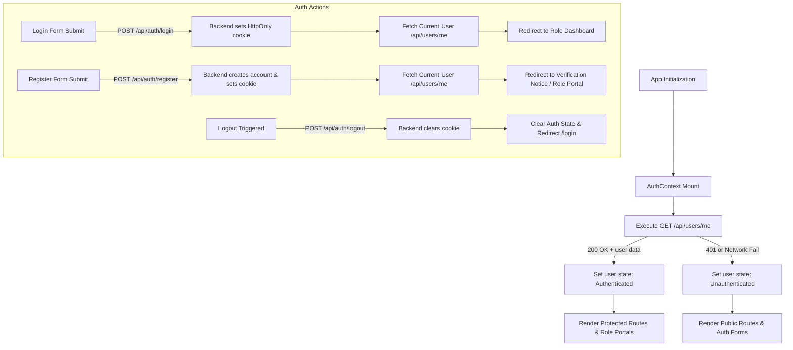

# Frontend Authentication Architecture & Backend Integration — SkillOrbit AI

> Phase 2.1 · Authentication UI & Backend Integration  
> **Status:** COMPLETE. Registration, login, logout, password recovery, email verification, cookie-based session restoration, role-based route guards, and UI integration are fully implemented and verified.

---

## 1. Scope & Architectural Overview

This document specifies the frontend authentication architecture for SkillOrbit AI and documents its integration with the backend Express authentication and user services.

The frontend is implemented with React 19, TypeScript (strict mode), Vite 8, Tailwind CSS v4, React Hook Form, Zod, and React Router 7. Authentication state is managed via React Context (`AuthContext`), exposed via the `useAuth` hook, and secured through HttpOnly cookies issued and managed entirely by the backend API.

### Core Architectural Decisions:
1. **Stateless HttpOnly Cookie Authentication**:
   - Access tokens (JWT) are never stored in `localStorage`, `sessionStorage`, or in-memory JavaScript variables.
   - All authenticated requests are carried out with Axios instance configuration `withCredentials: true`.
   - The cookie `skillorbit_access` is set, renewed, and cleared by the backend server (`HttpOnly`, `Path=/`, `SameSite=lax`, `Secure` in production).
2. **Deterministic Session Restoration on App Boot**:
   - On application startup or refresh, `AuthContext` executes a single initialization check to `GET /api/users/me`.
   - If the HttpOnly cookie is present and valid, the user's authoritative profile (`id`, `fullName`, `email`, `role`, `status`, `isEmailVerified`) is populated into state.
   - If the request returns 401 Unauthorized or fails, state gracefully resets to unauthenticated (`user = null`), with zero intrusive alerts.
3. **Strict Zero-Token Exposure**:
   - Frontend application logs, error reporting, and console outputs never log passwords, raw tokens, or sensitive user secrets.
4. **Resilient Error Normalization**:
   - All API responses are intercepted and normalized through `normalizeApiError()` in `api.ts`, returning typed `ApiClientError` instances that conform to the backend's standardized error schema (`{ success: false, message, code, errors }`).
5. **Declarative Route Protection & Role Authorization**:
   - `ProtectedRoute` ensures only authenticated users can access private application areas, saving attempted URLs in navigation state for post-login return.
   - `RoleGuard` restricts routes to designated user roles (`seeker`, `employer`, `provider`, `admin`), redirecting unauthorized users to their designated role portal.

---

## 2. Authentication Flow & State Lifecycle



---

## 3. AuthContext & useAuth Hook

### 3.1 Architecture & Fast Refresh Isolation
To comply with Vite's React Fast Refresh constraints (`react-refresh/only-export-components`), the context definition is split across two modules:
- `frontend/src/context/auth-context.base.ts`: Declares and exports the `AuthContext` React context object and associated TypeScript interfaces.
- `frontend/src/context/AuthContext.tsx`: Implements the `AuthProvider` component, managing internal state and lifecycle hooks.
- `frontend/src/hooks/useAuth.ts`: Exposes the custom consumer hook with runtime boundary enforcement (throws if invoked outside `<AuthProvider>`).

### 3.2 State Interface (`AuthState`)
```typescript
export interface AuthState {
  user: User | null;
  isAuthenticated: boolean;
  isLoading: boolean;
}
```

### 3.3 Context Interface (`AuthContextValue`)
```typescript
export interface AuthContextValue extends AuthState {
  login: (credentials: LoginCredentials) => Promise<User>;
  register: (payload: RegisterPayload) => Promise<User>;
  logout: () => Promise<void>;
  refreshUser: () => Promise<User | null>;
}
```

### 3.4 Key Responsibilities
- **Mount Life-cycle**: Runs `refreshUser()` on initial mount with a cleanup flag preventing state updates on unmounted trees.
- **Login**: Dispatches `authService.login(credentials)`, re-fetches authoritative user profile via `authService.getCurrentUser()`, updates context state, and returns the user object for downstream navigation.
- **Registration**: Dispatches `authService.register(payload)`, re-fetches user profile via `getCurrentUser()`, updates state, and returns the created user.
- **Logout**: Dispatches `authService.logout()` (ensuring backend cookie clearance), sets `user: null` and `isAuthenticated: false`, even if the network call fails.
- **Session Refresh**: Exposes `refreshUser()` to trigger profile re-validation after external operations (e.g., email verification).

---

## 4. API Endpoint Integration Mapping

The frontend communicates with backend routes defined under `/api/auth` and `/api/users`. All endpoints adhere to the project's standard response envelopes:

| UI Flow / Operation | HTTP Method & Path | Request Payload / Params | Expected Success Response | Cookie Action |
|---|---|---|---|---|
| **Login** | `POST /api/auth/login` | `{ email, password }` | `200 OK`<br>`{ success: true, message, data: { user } }` | Sets `skillorbit_access` HttpOnly cookie |
| **Registration** | `POST /api/auth/register` | `{ fullName, email, password, role }` | `201 Created`<br>`{ success: true, message, data: { user, verificationToken? } }` | Sets `skillorbit_access` HttpOnly cookie |
| **Current User Check** | `GET /api/users/me` | *None (Cookie sent)* | `200 OK`<br>`{ success: true, data: { user } }` | Reads `skillorbit_access` cookie |
| **Logout** | `POST /api/auth/logout` | *None (Cookie sent)* | `200 OK`<br>`{ success: true, message: 'Logged out successfully' }` | Clears `skillorbit_access` cookie |
| **Forgot Password** | `POST /api/auth/forgot-password` | `{ email }` | `200 OK`<br>`{ success: true, message }` | None |
| **Reset Password** | `POST /api/auth/reset-password` | `{ token, newPassword }` | `200 OK`<br>`{ success: true, message }` | None (Redirects to `/login`) |
| **Verify Email** | `POST /api/auth/verify-email` | `{ token }` | `200 OK`<br>`{ success: true, message, data: { user } }` | None |
| **Resend Verification** | `POST /api/auth/resend-verification` | `{ email }` | `200 OK`<br>`{ success: true, message }` | None |

---

## 5. Page Specifications & Validation Logic

### 5.1 Registration Page (`/register`)
- **Fields**:
  - `fullName`: string, 2–100 characters.
  - `email`: normalized lowercase email string.
  - `password`: minimum 8 characters, requiring at least one lowercase, one uppercase, and one number.
  - `confirmPassword`: validated with `.refine()` to ensure exact match with `password`.
  - `role`: selectable role strictly restricted to `seeker`, `employer`, or `provider` (`admin` option is excluded).
  - `acceptTerms`: boolean checkbox required to be `true`.
- **Behavior**:
  - Displays role-selection cards with clear descriptions for job seekers, employers, and learning providers.
  - On submit: calls `register()` via `useAuth()`.
  - On success: redirects to `/verify-email?registered=true` so the user is guided to verify their email address.
  - If user is already authenticated when visiting `/register`, automatically redirects to their role dashboard.

### 5.2 Login Page (`/login`)
- **Fields**:
  - `email`: valid email address format.
  - `password`: required string with show/hide password toggle.
- **Behavior**:
  - On submit: calls `login()` via `useAuth()`.
  - On success: checks `location.state?.from` for return redirect; if not present, automatically routes user to their role-specific portal:
    - `seeker` $\rightarrow$ `/dashboard`
    - `employer` $\rightarrow$ `/employer/dashboard`
    - `provider` $\rightarrow$ `/provider/dashboard`
    - `admin` $\rightarrow$ `/admin/dashboard`
  - Prevents account enumeration by surfacing backend-normalized credentials error.
  - If user is already authenticated, automatically redirects to role dashboard.

### 5.3 Forgot Password Page (`/forgot-password`)
- **Fields**:
  - `email`: valid email address format.
- **Behavior**:
  - On submit: calls `authService.forgotPassword(email)`.
  - Shows success state with explicit reassurance that instructions have been dispatched if the email exists.
  - Never reveals whether an account exists for the given email (anti-enumeration defense).
  - Provides option to send again or return to login.

### 5.4 Reset Password Page (`/reset-password`)
- **Token Resolution**:
  - Extracts 64-character hexadecimal reset token from URL query string `?token=<hex>` or route parameter `/:token`.
  - If token is missing or malformed, displays an alert notifying the user of an invalid or expired link with a direct button back to `/forgot-password`.
- **Fields**:
  - `newPassword`: minimum 8 characters with lowercase, uppercase, and number constraints.
  - `confirmPassword`: verified for exact match.
- **Behavior**:
  - On submit: calls `authService.resetPassword({ token, newPassword })`.
  - On success: displays a success confirmation banner with automatic redirect to `/login`.

### 5.5 Verify Email Page (`/verify-email`)
- **Token Resolution**:
  - Supports token from query parameter `?token=<hex>` or path parameter `/:token`.
- **Auto-Verification on Mount**:
  - When a token is present, the page automatically dispatches `authService.verifyEmail(token)` on mount.
  - If successful: displays verified state, refreshes auth session via `refreshUser()`, and offers a button to access the dashboard.
  - If failed/expired: presents a clear error alert along with an inline **Resend Verification Email** form.
- **Informational Mode**:
  - When visited after registration without a token (`?registered=true`), displays informative instructions on checking the inbox, with the inline resend form readily available.

---

## 6. Route Protection & Authorization

### 6.1 `ProtectedRoute`
- Located in `frontend/src/components/common/ProtectedRoute.tsx`.
- Checks `isAuthenticated` and `isLoading` from `useAuth()`.
- While `isLoading` is true, displays an accessible full-page spinner.
- If unauthenticated, redirects to `/login` preserving `location.pathname` in `state.from`.

### 6.2 `RoleGuard`
- Located in `frontend/src/components/common/RoleGuard.tsx`.
- Checks if the authenticated user's `role` is present in `allowedRoles: UserRole[]`.
- If unauthorized:
  - If user is logged in but lacks required role, redirects to their assigned role portal (`/dashboard`, `/employer/dashboard`, `/provider/dashboard`, or `/admin/dashboard`).
  - If unauthenticated, redirects to `/login`.

---

## 7. Configuration & Environment Setup

The frontend consumes environment variables adhering to Vite standards:

| Variable | Type | Default | Description |
|---|---|---|---|
| `VITE_API_BASE_URL` | string | `http://localhost:5000/api` | Base URL for all backend REST API requests. Configured in `frontend/.env.development` and `frontend/.env.production`. |

Axios client configuration:
```typescript
const baseURL: string = import.meta.env?.VITE_API_BASE_URL ?? 'http://localhost:5000/api';

export const api: AxiosInstance = axios.create({
  baseURL,
  headers: {
    'Content-Type': 'application/json',
  },
  withCredentials: true,
});
```

---

## 8. Verification, Testing & Quality Assurance

### 8.1 Automated Unit & Validation Tests
- File: `frontend/test/auth-validation.test.ts`
- Executable via: `npm test` (or `node --experimental-strip-types --test test/auth-validation.test.ts`)
- Covers:
  1. Seeker registration schema acceptance.
  2. Rejection of forbidden `admin` self-registration.
  3. Rejection of mismatched passwords.
  4. Password minimum length and complexity enforcement.
  5. Mandatory terms and conditions acceptance.
  6. Login credential schema acceptance and email format rejection.
  7. Forgot password email formatting constraints.
  8. Reset password 64-character hex token verification and password matching.
  9. Resend verification email validation.
  10. Backend API error response normalization into typed `ApiClientError`.
  11. Network connectivity failure normalization.

### 8.2 Build & Lint Validation
- TypeScript Strict Mode: `tsc -b` passes with **0 errors**.
- ESLint: `npx eslint .` passes with **0 warnings and 0 errors**.
- Production Build: `npm run build` generates optimized client bundle in `frontend/dist`.

---

## 9. Known Constraints & Backend Interoperability Notes

1. **Local Development Cookie Handling (CORS & SameSite)**:
   - In local development, the frontend runs on `http://localhost:5173` and the backend on `http://localhost:5000`.
   - The backend sets `SameSite=lax` and credentials-allowed CORS (`credentials: true`, specific origin `http://localhost:5173`).
   - Browsers correctly attach the HttpOnly cookie for cross-port localhost requests when `withCredentials: true` is enabled.
2. **Email Delivery in Development**:
   - In local development where SMTP is not configured, the backend returns `data.verificationToken` during registration for developer convenience. The frontend safely handles this without displaying tokens to end users in production.
3. **Role Authorization Scope**:
   - For public registration, only `seeker`, `employer`, and `provider` are permitted. `admin` accounts can only be created via backend administrative seeders or authorized admin routes.
