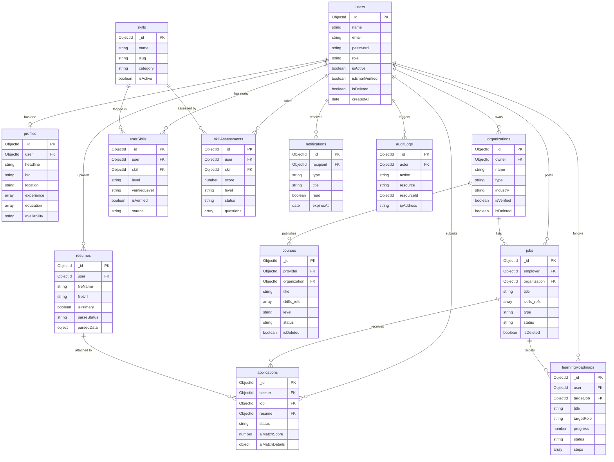

# Database Relationships — SkillOrbit AI

> Phase 1.4 · Database Architecture & Schema Design

---

## 1. Relationship Overview

SkillOrbit AI uses MongoDB with Mongoose. The data model mixes **referenced documents** (cross-collection `ObjectId` foreign keys) and **embedded documents** (sub-arrays inside a parent document). The choice between the two follows the rule:

> **Embed** when the data is accessed together with its parent, has bounded growth, and is owned exclusively by the parent.  
> **Reference** when data has independent lifecycle, is shared between multiple parents, or has unbounded growth.

---

## 2. Mermaid ER Diagram

---

## 3. Referenced Documents (Cross-Collection Foreign Keys)

Referenced documents are stored in a separate collection. Mongoose `.populate()` or aggregation `$lookup` is used to join them at query time.

### 3.1 `users` ← referenced by most collections

| Collection | Field | Relationship | Cardinality |
|---|---|---|---|
| `profiles` | `user` | Profile belongs to one user | 1 : 1 |
| `organizations` | `owner` | Org owned by one user | N : 1 |
| `resumes` | `user` | Resume belongs to one seeker | N : 1 |
| `userSkills` | `user` | UserSkill belongs to one user | N : 1 |
| `skillAssessments` | `user` | Assessment taken by one user | N : 1 |
| `learningRoadmaps` | `user` | Roadmap follows one user | N : 1 |
| `jobs` | `employer` | Job posted by one employer | N : 1 |
| `applications` | `seeker` | Application submitted by one seeker | N : 1 |
| `notifications` | `recipient` | Notification targets one user | N : 1 |
| `auditLogs` | `actor` | Log entry triggered by one user (nullable) | N : 0..1 |

### 3.2 `skills` ← referenced by multiple collections

| Collection | Field | Relationship | Cardinality |
|---|---|---|---|
| `userSkills` | `skill` | UserSkill maps to one skill | N : 1 |
| `skillAssessments` | `skill` | Assessment tests one skill | N : 1 |
| `jobs` | `skills[]` | Job requires many skills | N : M |
| `courses` | `skills[]` | Course teaches many skills | N : M |

### 3.3 `jobs` ← referenced by downstream collections

| Collection | Field | Relationship | Cardinality |
|---|---|---|---|
| `applications` | `job` | Application targets one job | N : 1 |
| `learningRoadmaps` | `targetJob` | Roadmap generated for one job (optional) | N : 0..1 |

### 3.4 `organizations` ← referenced by activity collections

| Collection | Field | Relationship | Cardinality |
|---|---|---|---|
| `jobs` | `organization` | Job belongs to one organisation (optional) | N : 0..1 |
| `courses` | `organization` | Course belongs to one organisation (optional) | N : 0..1 |

### 3.5 `resumes` ← referenced by applications

| Collection | Field | Relationship | Cardinality |
|---|---|---|---|
| `applications` | `resume` | Application attaches one resume (optional) | N : 0..1 |

---

## 4. Embedded Documents

Embedded documents are stored inside their parent as sub-arrays or nested objects. They are accessed only through the parent and have no independent MongoDB collection.

| Parent Collection | Embedded Field | Sub-Document Schema | Max Growth | Reason for Embedding |
|---|---|---|---|---|
| `profiles` | `experience[]` | `{ title, company, location, startDate, endDate, description }` | ~20 items | Always fetched with profile; owned exclusively |
| `profiles` | `education[]` | `{ institution, degree, field, startDate, endDate, grade }` | ~10 items | Always fetched with profile; owned exclusively |
| `resumes` | `parsedData` | `{ extractedSkills, yearsOfExperience, educationLevel, summary, rawText }` | 1 object | One parse result per resume file |
| `jobs` | `salary` | `{ min, max, currency, isPublic }` | 1 object | Always loaded with job; tightly coupled |
| `courses` | `syllabus[]` | `{ moduleTitle, lessons[], duration }` | ~30 modules | Displayed on course detail page; owned by course |
| `learningRoadmaps` | `steps[]` | `{ order, title, description, type, resourceId, resourceUrl, isCompleted, completedAt }` | ~50 steps | Roadmap steps are meaningless without parent |
| `skillAssessments` | `questions[]` | `{ questionText, options[], selectedAnswer, correctAnswer, isCorrect }` | ~50 questions | Test session data; owned by assessment |
| `applications` | `aiMatchDetails` | `{ matchedSkills[], missingSkills[], experienceMatch, summary }` | 1 object | Match data is always accessed with application |
| `notifications` | `metadata` | `{ arbitrary key-value pairs }` | 1 object | Role-specific context; always loaded with notification |
| `organizations` | `socialLinks` | `{ linkedin, twitter, facebook }` | 1 object | Small, always loaded with org |

---

## 5. Cardinality Summary

| Relationship | Type | Implementation |
|---|---|---|
| user → profile | 1 : 1 | `profiles.user` unique ref |
| user → organizations | 1 : N | `organizations.owner` ref |
| user → resumes | 1 : N | `resumes.user` ref |
| user → userSkills | 1 : N | `userSkills.user` ref |
| user → skillAssessments | 1 : N | `skillAssessments.user` ref |
| user → learningRoadmaps | 1 : N | `learningRoadmaps.user` ref |
| user → jobs (posted) | 1 : N | `jobs.employer` ref |
| user → applications | 1 : N | `applications.seeker` ref |
| user → notifications | 1 : N | `notifications.recipient` ref |
| user → auditLogs | 1 : N | `auditLogs.actor` ref (nullable) |
| skill → userSkills | 1 : N | `userSkills.skill` ref |
| skill → skillAssessments | 1 : N | `skillAssessments.skill` ref |
| skill ↔ jobs | M : N | `jobs.skills[]` array of refs |
| skill ↔ courses | M : N | `courses.skills[]` array of refs |
| job → applications | 1 : N | `applications.job` ref |
| job → learningRoadmaps | 1 : N | `learningRoadmaps.targetJob` ref (optional) |
| organization → jobs | 1 : N | `jobs.organization` ref (optional) |
| organization → courses | 1 : N | `courses.organization` ref (optional) |
| resume → applications | 1 : N | `applications.resume` ref (optional) |
| seeker + job → application | unique pair | unique index `{ seeker, job }` |
| user + skill → userSkill | unique pair | unique index `{ user, skill }` |

---

## 6. Populate Strategy

### When to use `.populate()`

| Endpoint type | Fields to populate | Reason |
|---|---|---|
| Job detail page | `employer`, `organization`, `skills` | Full context needed for display |
| Application list (employer) | `seeker`, `job`, `resume` | Show applicant name + job title |
| Application list (seeker) | `job` | Show job title + employer |
| Course detail page | `provider`, `organization`, `skills` | Full context |
| User skill list | `skill` | Show skill name + category |
| Learning roadmap | `user`, `targetJob` | Context for AI re-generation |

### When NOT to populate (use projection instead)

| Scenario | Better approach |
|---|---|
| Dashboard summary counts | Use `countDocuments()` with a filter |
| Notification list | Store denormalised `title` in notification; no populate needed |
| Audit log list | Store `actorRole` and `action` strings directly |
| Search/browse job list | Return `_id`, `title`, `location`, `status` only — no deep populate |
| Leaderboard / ranking | Aggregation pipeline with `$group` + `$lookup` |

---

## 7. Data Integrity Rules

### 7.1 Cascade-delete considerations

MongoDB has no built-in cascading deletes. The application layer must handle cleanup:

| When this is deleted | Application must also… |
|---|---|
| `users` record (soft-deleted) | Set `isDeleted: true` on their `jobs`, `organizations`, `courses` |
| `jobs` record | Do not delete `applications` — archive them instead (`status: rejected`) |
| `courses` record | Do not delete enrollments — preserve learner history |
| `skills` record | Set `isActive: false` — do not delete `userSkills` or `skillAssessments` |

### 7.2 Orphan prevention

| Risk | Prevention |
|---|---|
| Application referencing deleted job | Filter `jobs.isDeleted: false` in all application creation guards |
| Resume attached to deleted user | Application-level soft-delete cascade |
| UserSkill pointing to inactive skill | Query with `skills.isActive: true` when displaying user skills |
| Notification with no recipient | Validate `recipient` exists before insert |

### 7.3 Unique constraints (enforced by MongoDB index)

| Collection | Unique constraint | Purpose |
|---|---|---|
| `users` | `email` | No duplicate accounts |
| `profiles` | `user` | One profile per user |
| `skills` | `name` | No duplicate skill names in catalogue |
| `skills` | `slug` | No duplicate URL slugs |
| `userSkills` | `{ user, skill }` | One proficiency record per user per skill |
| `applications` | `{ seeker, job }` | One application per seeker per job |

---

## 8. Database Security & Privacy

### 8.1 Field-level security

| Field | Collection | Security Measure |
|---|---|---|
| `password` | `users` | `select: false` on Mongoose schema; bcrypt hash only |
| `rawText` | `resumes.parsedData` | Excluded from default projection on list queries |
| `employerNote` | `applications` | Excluded from seeker-facing API responses |
| `ipAddress` | `auditLogs` | Restricted to admin role queries only |
| `userAgent` | `auditLogs` | Restricted to admin role queries only |
| `changes` | `auditLogs` | Restricted to admin role queries only |

### 8.2 Role-based data access

| Role | Can read | Can write |
|---|---|---|
| `seeker` | Own profile, own applications, public jobs, public courses | Own profile, own applications, own resumes |
| `employer` | Own jobs, applications to own jobs, public profiles (limited) | Own jobs, update application status |
| `provider` | Own courses, enrolled learners on own courses | Own courses |
| `admin` | All collections | All collections + `auditLogs` (read-only for admins) |

### 8.3 Data privacy considerations

| Concern | Approach |
|---|---|
| PII in `users` | Email, phone (in `profiles`) are PII — never logged in plain text; masked in audit logs |
| Resume content | `parsedData.rawText` contains PII — restricted to owner and admin |
| Salary data | `salary.isPublic: false` hides salary from applicant-facing endpoints |
| IP addresses | Stored in `auditLogs` for abuse detection; not exposed through API |
| GDPR / right to deletion | Soft-delete clears PII fields (`name → "Deleted User"`, `email → hashed`) |
| Notification content | `metadata` may contain IDs only — no full documents stored inline |
